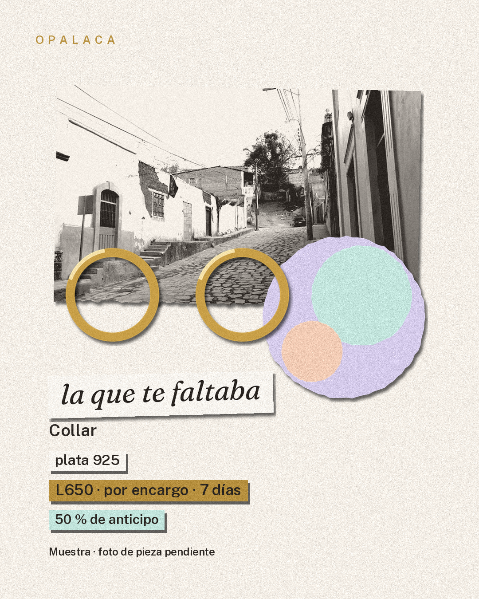
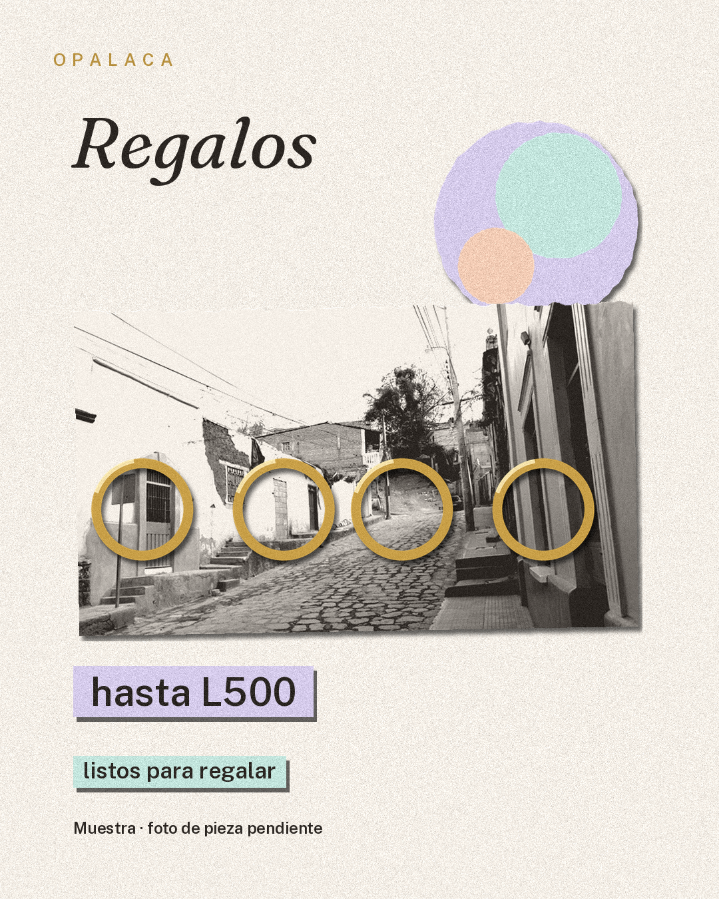
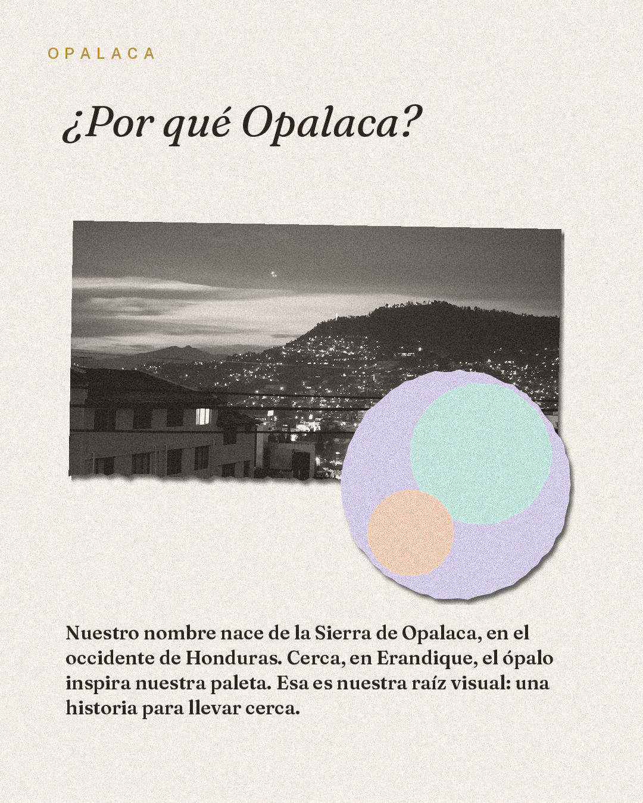
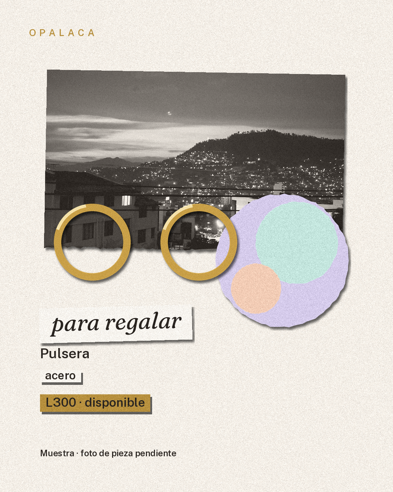

# Muestras · Ópalo de Erandique

Generadas con `python opalaca.py posts/ejemplos.yaml`. Siete PNG RGB de
1080 × 1350; cada uno tiene un pie `.txt` con atribución y llamada a WhatsApp.

**Solo demostración:** las argollas son marcadores, incluso en las composiciones
que dicen collar o pulsera. No hay fotos de productos ni stock/precios
confirmados. Las fotos de lugares son Wikimedia con créditos en
[fuentes/CREDITOS.md](../../fuentes/CREDITOS.md). El Picacho no representa
la Sierra de Opalaca. Las composiciones derivadas de `calle.jpg` se comparten
bajo [CC BY-SA 4.0](https://creativecommons.org/licenses/by-sa/4.0/).

| Producto | Encargo |
|---|---|
|  |  |

| Guía | Historia de marca |
|---|---|
|  |  |

| Carrusel · portada | Carrusel · pieza 1 | Carrusel · pieza 2 |
|---|---|---|
|  |  |  |

## Revisión del 18 de noviembre de 2026

Se abrieron individualmente los siete PNG y se revisaron tamaño, aire,
legibilidad, composición, duotono y un solo motivo de ópalo por lámina.

| Archivo | Tamaño | Márgenes ≥80 px | Ópalos | Acentos fuera del ópalo |
|---|---|---|---|---|
| argollas-oro | 1080 × 1350 | Sí | 1 | oro |
| collar-encargo | 1080 × 1350 | Sí | 1 | oro, menta |
| guia-500 | 1080 × 1350 | Sí | 1 | lavanda, menta |
| por-que-opalaca | 1080 × 1350 | Sí | 1 | ninguno |
| favoritos-01 | 1080 × 1350 | Sí | 1 | lavanda, menta |
| favoritos-02 | 1080 × 1350 | Sí | 1 | oro |
| favoritos-03 | 1080 × 1350 | Sí | 1 | oro |

El conteo de acentos excluye neutros, marca y producto/marcador. El motivo
único de ópalo tiene sus tres discos de papel. Todos los paisajes están en
duotono tinta → crema; los marcadores conservan su color dorado.

Validación técnica: 14 pruebas automatizadas pasan. Se generaron también
las siete láminas en historia, Navidad feed y Navidad historia: 28 PNG en
total, tamaños comprobados y sin EXIF, XMP ni ICC. Se revisaron visualmente
composiciones representativas de esas variantes; quedan fuera de Git.
La conservación del color/alfa de una joya se probó con imágenes sintéticas
PNG RGB/RGBA e indexadas. Falta validar recortes sobre fotos reales de stock.
