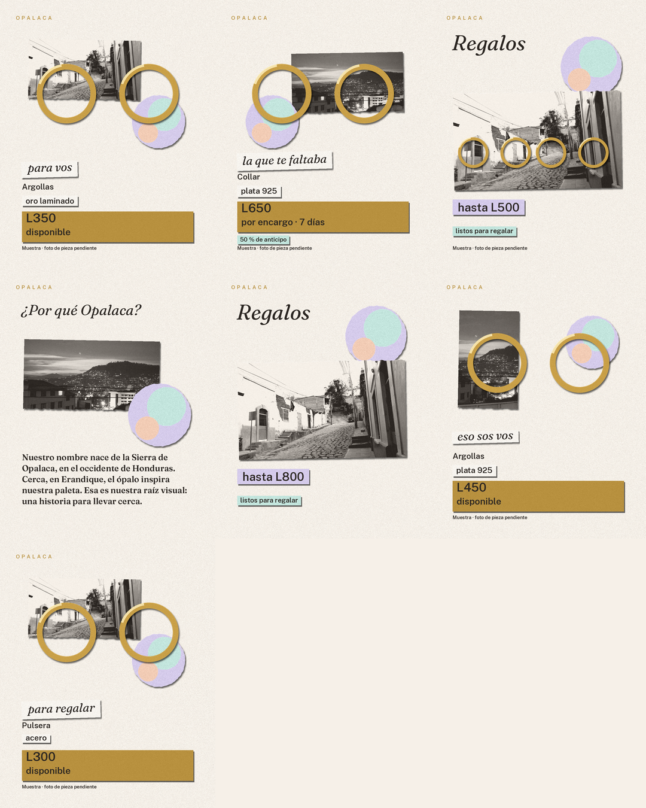
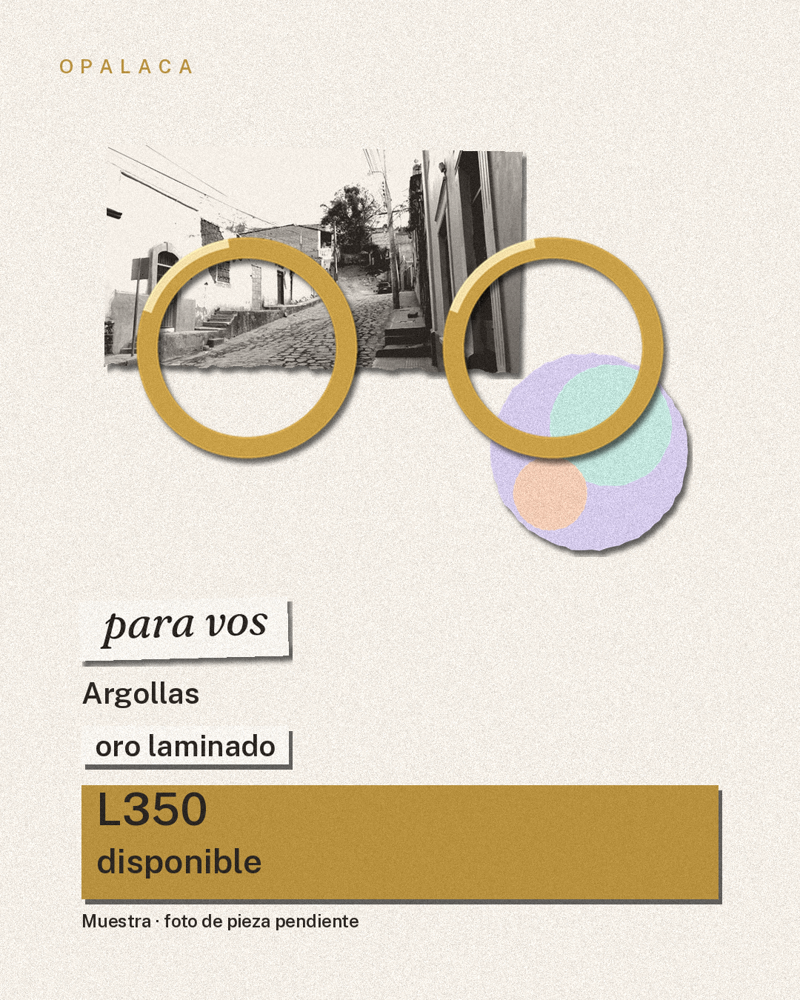
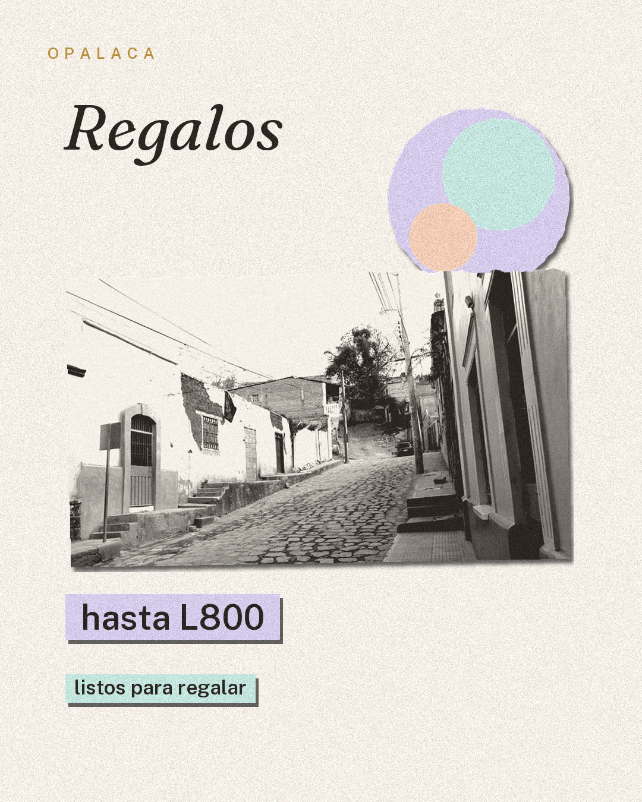
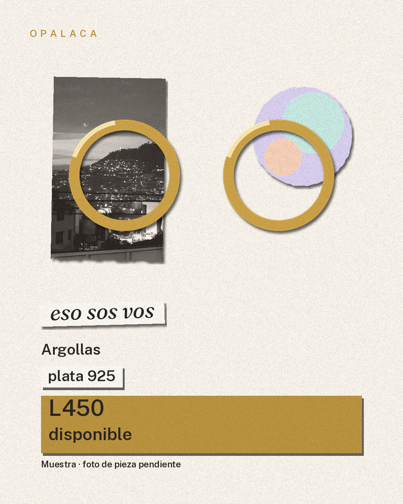

# Muestras · Ópalo de Erandique

Generadas con `python opalaca.py posts/ejemplos.yaml`. Siete posts PNG RGB de
1080 × 1350 y sus pies `.txt`, más `hoja.png`: cuadrícula 3 × 3 de miniaturas
360 × 450, en orden YAML, incluyendo las tres láminas del carrusel. Las dos
celdas finales quedan vacías; la hoja no es un post de Instagram.

**Solo demostración:** las argollas son marcadores, incluso en las composiciones
que dicen collar o pulsera. No hay fotos de productos ni stock/precios
confirmados. Los créditos de las fotos y de la hoja están en
[fuentes/CREDITOS.md](../../fuentes/CREDITOS.md). El Picacho no representa
la Sierra de Opalaca. El TODO del YAML pide una foto propia del occidente,
Intibucá o Lempira, que lo sustituya en la historia.

Las composiciones derivadas de `calle.jpg` y la hoja se comparten bajo
[CC BY-SA 4.0](https://creativecommons.org/licenses/by-sa/4.0/).

| Producto · A | Encargo · B |
|---|---|
|  |  |

| Guía | Historia de marca |
|---|---|
|  |  |

| Carrusel · portada | Carrusel · C | Carrusel · A |
|---|---|---|
|  |  |  |

## Revisión visual y técnica

Se abrieron individualmente los siete posts y la hoja. Dimensiones correctas,
márgenes ≥80 px, un motivo de ópalo por lámina y no más de dos acentos.
Los paisajes siguen en duotono y la joya conserva su color. En producto y
encargo los marcadores miden 720 px de ancho visible (66.7 %), centrados.

| Lámina | Layout | Lugar |
|---|---|---|
| argollas-oro | A | calle |
| collar-encargo | B | picacho |
| guia-500 | guía | calle |
| por-que-opalaca | historia | picacho (temporal; TODO) |
| favoritos-01 | guía | calle |
| favoritos-02 | C | picacho |
| favoritos-03 | A | calle |

No se repiten lugares consecutivos. La rotación de productos continúa dentro
del carrusel; `--solo` conserva la variante. Precio a 60 px, estado a 46 px,
material a 40 px y relato a 42 px. La CLI rechaza desbordamientos sin bajar
de los mínimos 46/46/36/40 px respectivamente.

**23 pruebas automatizadas pasan**, incluyendo las 24 combinaciones de
layout × producto/encargo × formato × tema. Comprueban ancho visible y centro
con PNG sintético con relleno transparente, tamaños tipográficos reales,
rotación y layouts forzados, rechazo de lugares repetidos, obligatoriedad del
lugar en historia, errores sin escritura parcial, y orden/dimensiones de la
hoja. Las fotos demasiado estrechas o vacías generan un error, no una joya
silenciosamente más pequeña.

También se generaron las siete láminas y su hoja en historia, Navidad feed y
Navidad historia: 28 posts + 4 hojas, sin EXIF/XMP/ICC. Las variantes quedan
fuera de Git. Las muestras siguen requiriendo fotos reales autorizadas para
validar la separación de fondos sobre el stock.
